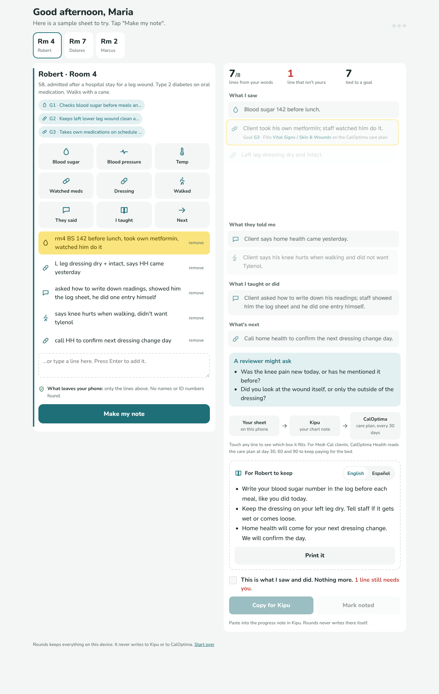
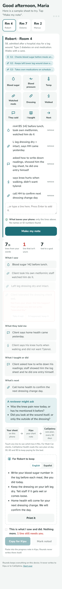

# Rounds

> For the LVN or medical assistant on a recuperative care floor: you jot during rounds, it drafts the progress note and a plain-language teach sheet, and every line points back to what you wrote. You sign.

**Team:** Rounds
**Members:** [names]
**Challenge:** 3 · Make AI approachable
**Built at:** Orange County | Claude Impact Lab, October 17, 2026, with Illumination Health + Home

## The problem

An LVN or MA at IHH sees 15 to 20 clients a shift: vitals, watching clients take their own medications, blood sugars, dressings, teaching. Every contact needs a note in Kipu, in a set format, tied to the client's care plan goals, and those notes are the evidence the health plan reads about every 30 days to decide whether the stay continues. Notes get written at the end of the shift from memory or paper. IHH already has an AI note tool inside Kipu and staff don't use it: it records audio in the room, it was built for hour-long therapy sessions, and the fears staff named are real: client information going somewhere it shouldn't, a note that says something that didn't happen, and being the first step to fewer staff.

## What we built

Rounds is the nurse's pocket "brain sheet," on a phone. No install (add to home screen), no login, no microphone, no connection to Kipu. The word "AI" appears nowhere in it.

1. **The whiteboard.** Rooms across the top, like the unit board. Tap a room. The client's care plan goals show as chips.
2. **Tap, don't type.** Nine tiles: blood sugar, blood pressure, temp, watched meds, dressing, walked, they said, I taught, next. A tile asks only for the number or a few words, with one-tap context ("before lunch", "with walker"). Each tap becomes a line on the sheet, with an icon. Free text is still there for anything else.
3. **What leaves your phone.** Names and ID-like numbers are removed in the browser before anything is sent, and the sheet says so in one line.
4. **Make my note.** The draft slides in, grouped as *What I saw / What they told me / What I taught or did / What's next*. Touch any line and the sheet line it came from lights up yellow, like a highlighter. The same touch shows which box on the CalOptima care plan that line fills. A deterministic checker, not the AI, flags:
   - **red**: a line with no jotting behind it, a number that isn't in your jottings, or a filler phrase you didn't write ("tolerated well", "denies pain")
   - **amber**: interpretation an LVN doesn't document ("indicates", "consistent with", diagnosis words)
   You remove or keep each flagged line. The note cannot be copied until every flag has your decision.
5. **A reviewer might ask.** Up to three questions. Rounds never answers them for you.
6. **Where it goes.** Your sheet → Kipu (your chart note) → CalOptima (care plan, every 30 days). Nurses are rarely shown this; it is why the note matters.
7. **For the client to keep.** The same sheet becomes a plain-language teach sheet, English and Spanish, containing only the teaching you actually gave. Print it. This is aimed at the other time sink staff named: repeating the same counseling client after client.
8. **Sign.** "This is what I saw and did. Nothing more." Copy for Kipu, paste into the progress note. Mark noted, and the room gets a check on the whiteboard: noted at the time, not at 6pm.

### Why it looks the way it does

- Nunito for the interface (rounded, big x-height, reads at a glance); Atkinson Hyperlegible for the note text itself, a face designed for legibility. No handwriting font: nurses read fast under bad light.
- One brand color (scrub teal), highlighter yellow for the trace, coral only for "not your words". 48px touch targets, one-hand phone layout.
- Two motions only: the lines sliding into the note, and the highlighter. Reduced-motion respected.
- Copy says "your sheet", "your words", "make my note". Never "AI", "model", "generate".

### The path to the systems IHH can't change

- **Kipu (EMR):** Phase 1 is copy and paste into the progress note; the note is already structured JSON, so a Kipu integration is a mapping job, not a rewrite. We have not verified IHH's Kipu contract or API access.
- **CalOptima Health (funder for Medi-Cal clients):** verified from CalOptima's Community Supports Provider Program Guide (Jan 2026): recuperative care is auto-authorized for 30 days; days 31–60 and 61–90 need a reauthorization in **CalOptima Health Connect** with the **care plan, including discharge planning notes**, uploaded. The care plan form (Appendix I) has the boxes our sections map to: Vital Signs; Care Preferences and Concerns Voiced by Member; Health Education/Interventions Provided; Interventions with status; Member Appointments. Phase 2 of Rounds assembles the signed notes into that field order at day 25/55/85 for whoever uploads. The nurse never touches Health Connect.

**Demo video:** [link]





## How Claude is used

- Built with Claude Code during the event.
- At run time, Claude turns the stripped jottings and the care plan goals into structured JSON: sections, sentences, and for each sentence the exact source text it came from and the goal it supports. The prompt is in [`server/prompt.js`](server/prompt.js), readable by any nurse or supervisor.
- What a person checks: everything. The browser re-verifies every sentence against the jottings with plain string and number matching ([`public/verify.js`](public/verify.js)). The AI's own claim of a source is not trusted; it is checked.

## Try it

```bash
git clone <this repo>
cd rounds
npm install
npm start
# open http://localhost:3000
```

Needs Node 18 or newer. Without an API key it runs in **demo mode**: the three sample clients work with hand-written outputs so anyone can see the full flow in 60 seconds. To draft your own jottings with Claude:

```bash
cp .env.example .env
# put your Anthropic API key in .env
npm start
```

Run the checks on all samples: `npm run eval` (writes `eval/results.md`).

## What is real and what is mocked

| Part | Status |
|---|---|
| Privacy strip (names, DOB, MRN, phone, SSN-like, long numbers) in the browser | working |
| Line-by-line verification: source match, number match, filler and scope words | working, deterministic |
| Review gate: no copy until every flagged line is decided | working |
| Care plan goal linking, "not in your jottings" questions, bilingual teach sheet | working (live) / hand-written (demo mode) |
| Claude drafting | working when `ANTHROPIC_API_KEY` is set; **demo mode uses hand-written outputs** for the three sample clients, written to imitate real model output including one added sentence and one interpretation so the checks can be seen working |
| Clients and care plan goals | made up; three samples |
| Kipu integration | none, by design. Output is text you paste. Rounds never reads or writes IHH systems |
| Name, rooms noted today | stored in the browser only |
| Tile composing, highlighter, CalOptima box mapping | working; the mapping is our reading of CalOptima's Appendix I, not confirmed with CalOptima or IHH |

## Where it gets things wrong

- The checker only knows what you typed. If you jot "BS 142" and meant 124, the note says 142 and nothing catches it.
- The scope-word list is short and English-only. A model can interpret without using any of those words.
- Spanish teach-sheet lines are not verified against the English ones beyond numbers.
- The privacy strip is pattern-based. A name it hasn't been told about, or an unusual ID format, gets through. For sample clients it knows the names; for real use IHH would supply the list.
- We have not tested on real IHH note templates or against what CalOptima actually asks for at reauthorization. The sections here are our best guess from the role card.
- Live model output varies. In demo mode the flagged lines are planted; in live mode they appear when the model slips, which in our experience is sometimes, not always.

## Next steps

What it would take to pilot: IHH's real note template and goal list for one site; a review by one LVN and one supervisor of ten drafts; a client-name list for the strip; hosting behind IHH's login. With one more week: offline-first on a shared tablet, a per-nurse phrase library, and the check that matters most, which is whether a note drafted this way carries the 30-day review.

## Data and privacy

This project uses only made-up clients and the event repo. It contains no real patient or client information. It does not connect to any Illumination Health + Home system. Nothing typed into Rounds is stored by Rounds; the API call to Claude carries only the stripped jottings and the care plan goals.

## License

[MIT](LICENSE)
